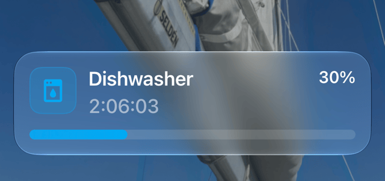

# Appliance Auto Notify

[](https://github.com/rhizomatics) [![hacs][hacsbadge]][hacs]
[](https://github.com/rhizomatics/appliance_autonotify/actions/workflows/ci.yml)
[](https://github.com/rhizomatics/appliance_autonotify/actions/workflows/deploy.yml)


Automatic notifications for household appliances in Home Assistant, with no automations or YAML.



When a dishwasher, washing machine, oven or other appliance starts a cycle, you're told it started, your phone shows a [Live Activity](https://companion.home-assistant.io/docs/notifications/live-activities) with progress
and time remaining while it runs, and you're told when it finishes.

It works with Bosch, Neff and Siemens appliances connected with the Home Assistant [Home Connect](https://www.home-assistant.io/integrations/home_connect/) integration, robot vacuums using the [Vacuum Integration](https://www.home-assistant.io/integrations/vacuum/) and Samsung washers, dryers and dishwashers through [SmartThings](https://www.home-assistant.io/integrations/smartthings/)
or [LocalThings](https://github.com/mbillow/localthings), in English only. Any other appliance can be added by hand if it has a power monitor, such as a smart plug.

## What You Need

- Home Assistant 2026.7 or later
- An appliance set up with the Home Connect, SmartThings or LocalThings integration, a robot vacuum of any make, or
  one with a power sensor
- [Supernotify](https://supernotify.rhizomatics.org.uk), installed from HACS, for Live Activities and for anything beyond a plain notification.
  - Optional, however without Supernotify, it only sends a start and an end notification, to every phone with the Home Assistant app unless you choose other notify entities.
  - `v2.14.0` recommended as minimum, though most features will work with earlier releases
- Home Assistant app installed on an Apple mobile device, minimum iOS 17.2, or on an Android one, where a
  [Live Update](https://companion.home-assistant.io/docs/notifications/live-activities) needs Android 16 or later, and earlier versions show an ordinary notification with a progress bar.


## Install

[](https://my.home-assistant.io/redirect/hacs_repository/?owner=rhizomatics&repository=appliance_autonotify&category=integration)

1. Use the button above, or in HACS search for *Appliance Auto Notify* and restart Home Assistant
   - Appliance Auto Notify is in the default HACS catalogue, so no need to add any custom repository
2. In *Settings*, *Devices & services*, choose *Add integration* and pick *Appliance Auto Notify*
3. Leave *Set up appliances automatically* on, and submit

That's all. Every appliance with a cycle Home Assistant reports is set up straight away, and so is any you add later. Each is listed on the integration's page, alongside *Automatic discovery*, and notifies with no further settings.

To stop the notifications for an appliance, disable it rather than delete it, since a deleted appliance is found and set up again.

### Choosing Appliances Yourself

Turn *Set up appliances automatically* off, on the first screen or later from the settings of *Automatic discovery*, and appliances are instead offered as *Discovered* on the *Devices & services* page. Choose *Add* to set one up, or *Ignore* on any you don't want.

### Appliances Through Other Integrations

An appliance is found by what its entities do, not by the integration they come from: a sensor of the state of its cycle, whose states include one of a cycle under way, along with whichever of its stage, progress, finish time and program the integration reports. Integrations name these differently, and use different words for the same states,
`run` or `active` for a cycle under way and `stop` or `finished` for its end, so both are kept as lists of the names and states known, which is all another integration with the same kind of entities needs.

A stage that means the cycle is over ends it there, such as a dryer's *Wrinkle prevent*, when it only tumbles its load now and then so it won't crease, though its cycle state stays running for as long as that goes on, and running on from there isn't a new cycle until the cycle state has said it's over.

The same appliance through two integrations, as a Samsung one is through SmartThings and LocalThings, which share its `id`, is set up once, through the integration that reaches it on the local network rather than through the vendor's cloud, or failing that the one that tells more of its cycle. The other is only listened to while the first can't be
heard from, though an end it told meanwhile still counts once the first goes quiet. An appliance already set up through one isn't offered again when the other is added, and one offered through the cloud is offered through the local network instead once that's found.

### Robot Vacuums

A robot vacuum of any make, through whichever integration Home Assistant has for it, is found and set up like the other appliances.

Cleaning is the cycle: it starts as the vacuum sets off, and ends once it has been back on its dock, or stopped by itself, for 10 minutes after saying it was on its way back. That wait is *Wait on the dock* in the *End message* settings of the vacuum, to raise for one that goes back part way through
to wash its mop or empty its bin, or lower for one that never does. A vacuum that goes straight to its dock from cleaning, as one does part way through to wash its mop or fill its tank, is given 30 minutes to set off again
before its cleaning is taken to be over.

Where the vacuum reports its own progress, as Roborock does, its cleaning is over 30 seconds after it's back on its dock with its progress at 100%, rather than waiting. Any percentage of the vacuum's
other than its battery that climbs to 100 during a cleaning is taken for its progress, so one that doesn't reach 100, such as a brush's life left, makes no difference.

Where the vacuum has a sensor of its own for whether it's cleaning, as Roborock's *Cleaning* is, that is followed instead: back on its dock with it still on is the same cleaning, for as long as 6 hours, as when it
recharges part way through to carry on, and once it goes off the cleaning is over 30 seconds after it's back. Any *running* sensor of the vacuum's that comes on within a minute of it setting off is taken for this, so
one that only comes on once it's back, such as its mop drying, makes no difference.

Paused, or on its way back, it's still the same cleaning too, and paused once
back on its dock is still the end. A cleaning under way when Home Assistant restarts still has its end told. One that stays in error for 10 minutes while out is told of with a notification of its own, *Bruno needs help*, rather than the end, since some integrations
report a past error again for a while as they reconnect, with the vacuum carrying on.

Where the vacuum's integration reports them, as Roborock's does, its *Cleaning mode* is its program, its *Status*, such as sweeping or relocating, is its status, and its *Cleaning progress* fills the bar of the Live Activity,
once it has dropped from the 100% left by the cleaning before. A vacuum has no time left to show, so its *Live Activity shows* is the *Program and status* by default, such as "Vac and mop · Sweeping", and its *Live Activity title* the *Appliance name only*.

### Power Monitored Appliances

An appliance with no supported integration can be added if a sensor measures the power it draws.

1. On the integration's page, choose *Add service*
2. Give the appliance a name, and choose its power sensor

A power monitor named for a washing machine, dryer, dishwasher or oven, in English or in the language of Home Assistant, such as a smart plug called *Washing machine* or *Lavatrice*, is found by itself and offered as *Discovered*, with its sensor and plug already filled in. It's never set up without asking, even with *Set up appliances automatically* on, since a name is only a guess, and the threshold is worth checking first. Estimated or derived power sensors, such as Powercalc's, are left out.

| Setting         | Default    | What it does                                                                              |
| --------------- | ---------- | ----------------------------------------------------------------------------------------- |
| Power threshold | 1 W        | The appliance is running while it draws more than this                                    |
| Grace period    | 60 seconds | How long power must stay at or below the threshold before the cycle is over, so short drop outs are ignored |
| Minimum running time | 0 seconds | How long power must have been above the threshold before it counts as a cycle, so a door opened or a button pressed is ignored |
| Smart plug      | None       | The switch the appliance is plugged into, offered as a button on the end notification to switch it off |

Raise the grace period for appliances that pause mid-cycle, such as a washing machine soaking. Set a minimum running time, 60 seconds or so, for appliances that draw a little power when their door is opened or a button pressed, such as a
dishwasher whose light comes on, so that isn't notified as a cycle. Time above the threshold adds up across drop outs shorter than the grace period, so a cycle that pauses as it starts still counts.

### The Appliance's Device

Each appliance gets a device of its own, listed under it on the integration's page with its model and area. It
shares the identifiers of the device the appliance already has, from Home Connect, SmartThings, LocalThings or the
vacuum's integration, so each shows the other under *Linked devices*, with the integration's icon, as Home Assistant
does for the same hardware through two integrations, such as a camera through UniFi and ONVIF. Appliances are still
found by what their entities do, not by their integration, and the device is only where the appliance is shown.

A power monitored appliance's device is *connected via* the smart plug, since the plug is other hardware, and has no
device to link to if its power sensor has none.

## Settings

Nothing needs changing for notifications to work. Each appliance on the integration's page has settings:

- *Notify Start* and *Notify End* switches
 - the start off and the end on by default
- *Notify phases* switch
  -  on by default for ovens
- *Notify progress* switch
  - off by default, switch on to get the percentage or ETA regularly notified
- a choice of *Live Activity title* and of what the *Live Activity shows*
  - Choose to have the main title be the appliance name and the programme name ("Dishwashed Intensive 70C"), or only the appliance name or programme
  - Choose to have the 2nd line of live activity be the countdown clock, the programme name, the status, such as "Drying" or "Relocating", or the programme and status together
  - Supernotify required for these options
- *Dashboard to open*
  - when a notification or the Live Activity is tapped.
  - Can be any Home Assistant dashboard, use one for all appliances, or create a dashboard just for that appliance and hide it from the app side panel so it doesn't clutter up the ap
  - Set when the appliance is added to a dashboard named for it, such as "Dishwasher", or for its type, such as "Washing Machine" for a washer, by its title or its path, so long as there's only one that matches. Change it or clear it like any other setting, it isn't set again

With *Notify start* or *Notify end* off, that notification isn't sent, but the Live Activity is still opened and closed, silently and on phones only. The dashboard is a choice of those in Home Assistant, never a URL to type in, so a notification can't be made to open anything else.

| Section              | What it does                                                                                 |
| -------------------- | -------------------------------------------------------------------------------------------- |
| Start message        | The title and message sent when the appliance starts, shown as they'll be sent, such as "Dishwasher started". Clear a box to go back to the usual wording. `{program}` is replaced by the program under way, as Home Assistant shows it, such as "Eco 50ºC", and by nothing for an appliance that reports none |
| End message          | The same for when it finishes, such as "Dishwasher is finished". With Supernotify, also a *Reminder*, see below |
| Notification targets | With Supernotify, *Targets* is the same choice of entities, devices, areas, floors and labels as any Supernotify notification, *Custom targets* is for those outside Home Assistant, such as e-mail addresses or phone numbers, and *Deliveries* limits notifications to those chosen. Leave them empty for Supernotify to choose. Without Supernotify, *Targets* is a choice of notify entities, and left empty means every phone with the Home Assistant app |

*Live Activity shows* is the *Time remaining* by default, where the appliance reports when it will finish, or in its place the *Program*, the *Status*, or the *Program and status*, such as "Vac and mop · Sweeping". The program can be the whole cycle, or a phase of it, such as a pre-heat or a pre-rinse, so for some appliances it says more than the time left. The status is what the appliance is doing within its cycle, such as a dryer drying then cooling. Where the appliance reports only one of them, that one is shown.

With no timer, the message is seen, so *Appliance name and program* puts the program in the title only where the message doesn't already say it, such as "Jill · Vac and mop" over "Sweeping" with *Status* chosen.

On the Lock Screen of an iPhone the timer takes the place of the message, which is where the program otherwise goes,
so while there's a time left to show, *Live Activity title* is *Appliance name and program* by default, such as
"Dishwasher · Eco 50ºC". Choose *Program only* to have the program alone, or *Appliance name only* for program names
too long to fit, or for an appliance that's always on the same program.

## What Gets Sent

| When                                   | With Supernotify                                                    | Without             |
| -------------------------------------- | ------------------------------------------------------------------- | ------------------- |
| Cycle starts                           | A Live Activity opened silently on phones. With *Notify start* on, a start notification everywhere, which opens the Live Activity too | Nothing, or with *Notify start* on, a start notification |
| Every 5% of progress                   | Silent update of the Live Activity, on phones only, with the program under way as its message, such as "Eco 50ºC". With *Notify progress* on, a notification everywhere instead at every 10%, which updates the Live Activity too | Nothing, or with *Notify progress* on, a notification |
| Every 2% of progress, from 90%         | Silent update of the Live Activity, on phones only                  | Nothing             |
| Oven warming up                        | Silent update of the Live Activity as the oven warms, see below      | Nothing, or with *Notify progress* on, a notification |
| Oven up to heat                        | "Oven is pre-heated" everywhere, unless *Notify phases* is off       | The same notification, unless *Notify phases* is off |
| Cycle finishes                         | Live Activity closed, then an end notification everywhere, unless *Notify end* is off | End notification, unless *Notify end* is off |
| Cycle is aborted, or fails             | Live Activity closed, with no end notification                      | Nothing             |

Pausing and resuming an appliance counts as the same cycle. An appliance that is switched off, like an oven,
counts as finished.

### Buttons on the End Notification

With Supernotify, the end notification has buttons, in the language of Home Assistant where there's a translation (English and Italian so far):

| Button         | What it does                                                                                 |
| -------------- | -------------------------------------------------------------------------------------------- |
| Finished       | Acknowledges and clears the notification, and stops any reminder                                              |
| Remind Later   | Sends the end notification again later, after the *Reminder* minutes or, with none set, 30   |
| Switch Off     | Only for a power monitored appliance with a *Smart plug* chosen, and the *Switch Off button* setting left on. Switches it off, unless a new cycle has started since |

With a *Reminder* set in the *End message* section, the end notification is sent again after that many minutes, up to the *Reminder repeats* times, 3 unless changed, until *Finished* is pressed or the next cycle starts. Supernotify adds the buttons of its own scenarios after these, and Android shows only the first 3.

### Oven Pre-heating

An oven with no timer set has no progress to report, so while it warms up, on any program, the bar is its
temperature as a percentage of the one it's set to, and the message is the two of them, such as "Pre-heating,
150 of 200°C", or "Fast pre-heat" in place of "Pre-heating" while that is on.

Once the oven is as hot as asked for, or reports that pre-heating is finished, "Oven is pre-heated" is sent
everywhere as a notification of its own, unless *Notify phases* is off. The Live Activity stays until the oven is
switched off, and goes straight on to the program and the temperature, such as "Pizza setting, 200°C", updated
whenever the temperature has moved by 5 degrees. From then on the oven isn't taken to be warming up again,
however its temperature wanders, until it has been off. With a timer set, the bar then goes on to the progress
of the program.

All of this depends on Home Connect telling Home Assistant the temperature the oven is set to, as its *Setpoint
temperature* entity, or reporting that pre-heating is finished. Neither can be relied on:

- An oven started with its own knobs or buttons, rather than from the Home Connect app or Home Assistant, often
  leaves *Setpoint temperature* unavailable for the whole cycle, even though Home Connect itself knows it
- Many ovens send *Pre-heat finished* only now and then, or not at all

When neither is there, the oven is shown with its program and temperature as it heats, such as "Hot air, 150°C",
with no pre-heating bar and no "Oven is pre-heated" notification. Whether the *Setpoint temperature* entity has a
value while the oven is heating shows whether yours is affected.

### Icons

The icon of a notification follows the type of appliance: dishwasher, washer, dryer, washer dryer, oven, hob, hood,
coffee maker, cleaning robot or air conditioner. A power monitored appliance has none to go by, so its name is
used instead, as in "Washer" or "Kettle".

## Known Limits

- On a Samsung phone, the status bar chip, the Now Bar and the appliance's colour only show with the developer option
  *Live notifications for all apps* turned on. See [Android and iOS](docs/mobile_platforms.md) for everything each
  platform shows
- On Android the notifications go in their own *Appliances* channel, made with sound the first time, since a Live
  Update in the app's usual channel is silent. Its sound can be changed in the phone's settings for the Home
  Assistant app, and is kept from then on

- Pre-heating is the only phase of a Home Connect appliance's cycle there is to tell of, since Home Connect reports none for a dishwasher or washer, such as pre-wash or rinse
- An appliance with a stage but no progress, such as a Samsung one through SmartThings, has its Live Activity brought up to date only as its stage changes, so its time remaining may lag a change of its finish time until then

- If the appliance never reports the end of its cycle, the Live Activity stays on the phone until dismissed
- A cycle under way survives a Home Assistant restart: it isn't told of as started again, and the wait to see that it's over, or for a reminder, carries on from where it was, unless Home Assistant has been off for more than a day
- An appliance that stops without saying it has finished or been switched off is taken to be finished 10 seconds later, in case it carries on, as an oven does when its settings are changed
- An oven has no pre-heating bar until Home Connect first reports its temperature, which isn't known after a restart of Home Assistant until the oven is next heating
- An oven started from its own controls often has no pre-heating bar or pre-heated notification at all, since Home Connect may then never give Home Assistant the temperature it's set to, see [Oven Pre-heating](#oven-pre-heating)
- Progress, time remaining and the program are only shown where the appliance reports them, so never for a power monitored appliance
- A robot vacuum that goes back to its dock to recharge part way through, saying it's on its way back as it does at the end, has two cleanings told if it charges for longer than its *Wait on the dock*, unless it has a sensor for whether it's cleaning, since otherwise there's no telling that dock from the last
- A robot vacuum whose integration never says it's on its way back is told to be finished 30 minutes after it's back on its dock
- Some integrations, such as Ecovacs, report a robot vacuum docked within a second of setting off and keep to that while it cleans, so being docked that soon is only believed after 3 hours with nothing else heard, which is when one stopped just as it set off is told to be finished
- An oven still warming up when Home Assistant restarts is still shown as pre-heating, and told of once up to heat, unless it got there while Home Assistant was off. One switched on while Home Assistant was off isn't shown as pre-heating, since there's no knowing whether it has been up to heat, only with its program and temperature
- An oven with no timer set reports its progress as 100%, so that is what the bar shows once it's up to heat

## Known Issues

Both of these have been seen on an iPhone, and neither has a confirmed cause yet.

### Progress bar behind the appliance

The progress bar of the Live Activity can fall well behind, such as showing 40% while the appliance is at 74%.

The likely cause is iOS. Progress is sent with `silent: true`, so that the phone doesn't alert every 5%, and the
[Companion App](https://companion.home-assistant.io/docs/notifications/live-activities) sends silent updates at a
lower priority, which iOS may delay, batch or drop. This is a theory, since it hasn't been tested by sending the
updates without `silent`.

Turning on *Notify progress* sends each update as an ordinary notification, without `silent`, so is worth
trying if the bar matters more than the interruptions.

### Seconds shown as dashes

The time remaining sometimes has dashes in place of the seconds, such as `52:--` or `1:30:--`, on the Lock Screen
while the Dynamic Island shows a full countdown at the same moment.

The same finish time is sent however it ends up shown, and the Companion App has no setting for the format of the
timer, so this is down to the phone. The likely reason is that the Lock Screen is redrawn less often while it's
dimmed or always-on, so drops the seconds. This is also a theory, and nothing has been found that changes it.

## Development

```shell
uv sync
uv run pytest
uv run ruff check --fix && uv run ruff format
uv run mypy custom_components/appliance_autonotify
```

This component is an implementation of [RFC-0004](https://supernotify.rhizomatics.org.uk/latest/developer/rfcs/0004-household_appliances_auto_notifier/) from [Supernotify](https://supernotify.rhizomatics.org.uk)

If you liked this, try [Camera AutoNotify](https://camera-autonotify.rhizomatics.org.uk) - Instant notifications for Frigate (and other camera systems coming) with no config, no blueprints, no YAML, no automations.

[hacs]: https://hacs.xyz
[hacsbadge]: https://img.shields.io/badge/HACS-Default-blue.svg
